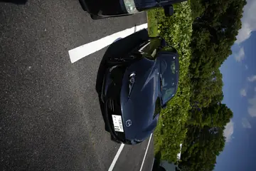
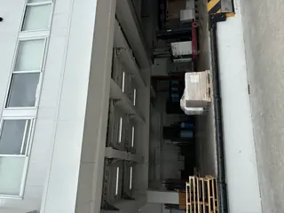
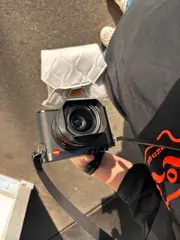
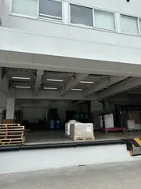
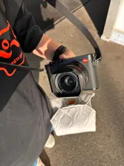

<div align="center">



# Kururi AI

**Puts sideways and upside-down photos the right way up.**

Kururi AI checks whether a photo is sideways or upside down, tells you how far to turn it,
and can save an upright copy. It is a command you run in Terminal on an Apple silicon Mac
or on x86-64 Linux, after a one-time download of about 700 MB. Everything runs on your own computer.

<sub><i>kururi</i> (くるり) is Japanese for “with a quick little spin”.</sub>

[](https://github.com/kandotrun/kururi-ai/releases/latest)
[](https://github.com/kandotrun/kururi-ai/actions/workflows/native-ci.yml)
[](LICENSE)
[](https://deepwiki.com/kandotrun/kururi-ai)

**[Try it in your browser](https://kandotrun.github.io/kururi-ai/)**&emsp;**[Download v2.0.0](#download)**&emsp;**[Quick start](#quick-start)**&emsp;[日本語で読む](README.ja.md)

</div>

## What it does

Give Kururi a photo and it answers with `correction_cw`: how many degrees to turn
the photo **clockwise** so that it stands upright.

<table>
  <tr>
    <th></th>
    <th>Parked car</th>
    <th>Warehouse</th>
    <th>Camera in hand</th>
  </tr>
  <tr>
    <th>Before</th>
    <td align="center"></td>
    <td align="center"></td>
    <td align="center"></td>
  </tr>
  <tr>
    <th>After</th>
    <td align="center"></td>
    <td align="center"></td>
    <td align="center"></td>
  </tr>
  <tr>
    <th>Turn</th>
    <td align="center"><code>270</code><br>¼ turn left</td>
    <td align="center"><code>90</code><br>¼ turn right</td>
    <td align="center"><code>180</code><br>half turn</td>
  </tr>
</table>

Kururi only makes quarter turns. It does not straighten a slightly tilted horizon.

## What's new in v2

v2 is a new standalone command-line tool with a new three-model engine. On the
same test photos as v1 it is right far more often, and on a 12 MP photo it
finishes much sooner:

| | v1 | **v2.0.0** |
|---|---:|---:|
| Correct answers (out of 704) | 626 (88.92%) | **700 (99.43%)** |
| Wrong answers | 78 | **4** (94.87% fewer) |
| Photos right in all four orientations (out of 176) | 141 (80.11%) | **175 (99.43%)** |
| Time for one 12 MP photo on an Apple M4 Max | 3.93 s | **0.42 s** (about 9.4× faster) |

<sub>Test: 176 private photos the models never trained on, each turned to 0°, 90°, 180° and 270° (704 cases). Both versions saw identical pixels. The result is measured on this collection only and is not a promise for every photo. Speed conditions and the remaining metrics are in <a href="#v1-vs-v2-in-detail">v1 vs v2 in detail</a>.</sub>

## Download

You need **two files** from
[GitHub Releases v2.0.0](https://github.com/kandotrun/kururi-ai/releases/tag/v2.0.0):
the program for your computer and the AI models.

| Your computer | 1. Program | 2. Models (same for both) |
|---|---|---|
| Mac with Apple silicon | [`kururi-ai-v2.0.0-macos-arm64.tar.gz`](https://github.com/kandotrun/kururi-ai/releases/download/v2.0.0/kururi-ai-v2.0.0-macos-arm64.tar.gz) (10 MB) | [`kururi-ai-v2.0.0-model.tar.gz`](https://github.com/kandotrun/kururi-ai/releases/download/v2.0.0/kururi-ai-v2.0.0-model.tar.gz) (693 MB) |
| Linux x86-64 | [`kururi-ai-v2.0.0-linux-x86_64.tar.gz`](https://github.com/kandotrun/kururi-ai/releases/download/v2.0.0/kururi-ai-v2.0.0-linux-x86_64.tar.gz) (12 MB) | the same model file |

Not sure which Mac you have? Choose Apple menu > About This Mac. If it shows
“Chip: Apple M…”, it has Apple silicon.

No Python is needed. There is no prebuilt program for Intel Macs, Windows, or
Linux on ARM. [`SHA256SUMS`](https://github.com/kandotrun/kururi-ai/releases/download/v2.0.0/SHA256SUMS)
lists the checksums of all release files.

> [!TIP]
> Just curious? The [browser demo](#browser-demo) needs no install.

## Quick start

**1. Download** both files into a new folder. On Linux, replace `macos-arm64` with
`linux-x86_64`.

```sh
mkdir ~/kururi && cd ~/kururi
curl -LO https://github.com/kandotrun/kururi-ai/releases/download/v2.0.0/kururi-ai-v2.0.0-macos-arm64.tar.gz
curl -LO https://github.com/kandotrun/kururi-ai/releases/download/v2.0.0/kururi-ai-v2.0.0-model.tar.gz
```

<details>
<summary>Optional: check the downloads before unpacking</summary>

```sh
curl -LO https://github.com/kandotrun/kururi-ai/releases/download/v2.0.0/SHA256SUMS
shasum -a 256 -c --ignore-missing SHA256SUMS
```

On Linux, use `sha256sum -c --ignore-missing SHA256SUMS`. Check before unpacking:
the program archive contains its own `SHA256SUMS`, which replaces the downloaded one.

</details>

**2. Unpack** both archives in the same folder.

```sh
tar -xzf kururi-ai-v2.0.0-macos-arm64.tar.gz
tar -xzf kururi-ai-v2.0.0-model.tar.gz
```

Now `kururi` (the command you run), its engine (`kururi-native` and the ONNX
Runtime library), and a `models/` folder sit side by side. Keep them together
and run the commands below inside this folder. Next time you open Terminal, go
back with `cd ~/kururi`.

> [!NOTE]
> **Downloaded with a browser instead?** Move both `.tar.gz` files into
> `~/kururi` and run the two `tar` commands there. If your browser already
> unpacked them, make sure the `models` folder ends up next to `kururi`.
>
> The macOS program has no Apple Developer ID signature and is not notarized.
> Files downloaded with `curl` are not affected. If macOS warns that it cannot
> verify `kururi-native`, run this once inside the folder that contains `kururi`:
> `xattr -dr com.apple.quarantine .`

**3. Ask about a photo.** Replace `~/Pictures/photo.jpg` with one of your own
photos. Easiest: type `./kururi predict --image ` (with a space at the end), then
drag the photo from Finder into the Terminal window to paste its path. This only
reads the photo. Nothing is written.

```sh
./kururi predict --image ~/Pictures/photo.jpg
```

**4. Save an upright copy** to a new file. The copy is re-encoded and does not
keep EXIF data such as the date, location, and camera; read
[Good to know](#good-to-know) before you delete any originals.

```sh
./kururi predict --image ~/Pictures/photo.jpg --output ~/Pictures/photo-upright.jpg
```

## Reading the result

Kururi prints one line of JSON. The answer is `correction_cw`; the rest is detail
such as scores, timings, and model information. The most useful fields, pretty-printed
(the values are only an example):

```json
{
  "correction_cw": 90,
  "probabilities": [0.004, 0.987, 0.003, 0.006],
  "accepted": true,
  "saved": false
}
```

| Field | Meaning |
|---|---|
| `correction_cw` | Degrees to turn **clockwise** to make the photo upright: `0` no turn needed, `90` a quarter turn right, `180` a half turn (it was upside down), `270` a quarter turn left |
| `probabilities` | Scores for turning 0°, 90°, 180°, and 270°, in that order |
| `accepted` | `false` when the top score is below `--min-confidence`; nothing is saved then |
| `saved` | `true` when an upright copy was written |

Kururi looks at the photo the way a photo viewer shows it: the camera's EXIF
rotation is applied first. So `correction_cw` is relative to what you see.

To print only the answer, pipe through [jq](https://jqlang.github.io/jq/), which
comes with recent macOS and is in every Linux package manager:

```sh
./kururi predict --image ~/Pictures/photo.jpg | jq .correction_cw
```

## Fix a whole folder

```sh
./kururi predict --dir ~/Pictures/trip --output-dir ~/Pictures/trip-upright
```

- Subfolders are included, and the same structure is recreated under
  `--output-dir`. The models load only once, so this is faster than running
  Kururi once per photo.
- `--output-dir` must not exist yet. Kururi creates it, but its parent folder
  must exist.
- Nothing is printed until the last photo is done, so a large folder can look
  stuck for minutes. Let it finish.
- The JSON lists every photo under `results`, each with its `path`. A photo that
  cannot be read gets an `error` instead, the other photos still run, and the
  exit code is `2`.
- Only files ending in `.jpg`, `.jpeg`, `.png`, `.webp`, `.tif`, `.tiff`, or `.bmp`
  are read. Other files, such as iPhone HEIC or camera RAW, and symbolic links
  are skipped and not copied. A file with one of those endings that cannot be
  decoded, such as a macOS `._photo.jpg` metadata file, is listed with an `error`.
- Photos held back by `--min-confidence` are not copied either.

To keep the report and list only the photos worth checking (the ones that were
turned, and the ones that failed):

```sh
./kururi predict --dir ~/Pictures/trip --output-dir ~/Pictures/trip-upright > trip.json
jq -r '.results[] | select(.error or .correction_cw != 0) | "\(.correction_cw // "error")\t\(.path)"' trip.json
```

## Good to know

- **Your originals are never changed.** Without `--output` or `--output-dir`,
  Kururi only reads. Output paths must be new: if the file or folder already
  exists, Kururi stops before doing any work.
- **Saved copies are re-encoded.** They do not keep EXIF data (date, location,
  camera) or color profiles. JPEG is saved at quality 75, so a little quality is
  lost. WebP is saved losslessly, so files can grow. The output format follows the
  file extension, and photos that needed `0` are re-encoded too.
- **Quarter turns only.** Slightly tilted photos are not straightened.
- **Supported formats:** JPEG, PNG, WebP, TIFF, and BMP. HEIC (the iPhone default)
  and RAW files (DNG, NEF, and others) cannot be read. Export them as JPEG first,
  for example with File > Export in Photos, so that they still show the right way
  up. Run `--dir` on a normal folder of exported files, not on the Photos library.
- **Scores are a hint, not a guarantee.** `--min-confidence 0.9` skips saving any
  photo whose top score is below 0.9 (`"accepted": false`). The default `0`
  saves everything.
- **Check before you delete anything.** Kururi can occasionally turn a photo
  that was already upright, and saved copies do not carry the original metadata.

## Options

| Option | What it does |
|---|---|
| `--image FILE` | Check one photo |
| `--dir FOLDER` | Check every supported photo in a folder, including subfolders |
| `--output FILE` | With `--image`: save an upright copy to a new file |
| `--output-dir FOLDER` | With `--dir`: save upright copies into a new folder |
| `--min-confidence N` | Do not save when the top score is below `N` (0 to 1, default `0`) |
| `KURURI_MODEL_DIR=PATH` | Environment variable: load the models from another folder (default: `models/` next to `kururi`) |

The word `predict` is optional with `kururi`. The launcher always uses 12 CPU
threads; to change that, run the engine `kururi-native` directly as shown in
[How it works](#how-it-works).

| Exit code | Meaning |
|---:|---|
| `0` | Finished, including photos that were not accepted |
| `1` | Stopped with an `Error:` message on stderr and no JSON, for example an unreadable `--image`, an output path that already exists, a value out of range such as `--min-confidence 1.5`, or a model that cannot be loaded (such as a missing `.onnx.data` file) |
| `2` | A `--dir` run finished but some photos failed (the JSON is still printed), `kururi` could not find one of the three `.onnx` model files, or an option is unknown, repeated, missing its value, or not allowed with the others (such as `--output` with `--dir`) |

## Browser demo

[kandotrun.github.io/kururi-ai](https://kandotrun.github.io/kururi-ai/) runs a
small **v2-nano** model (about 11.9 MB) inside your browser with ONNX Runtime Web.
Your photos are not uploaded anywhere.

The demo is for a quick try, not for fixing a whole photo library:

- It shows corrected previews only. It cannot save files.
- It is less accurate: 324 of 396 (81.82%) on a smaller test set made for the
  demo model, so the number cannot be compared directly with the tables here.

For your own photos, use the command-line tool. Demo details:
[web/README.md](web/README.md).

## v1 vs v2 in detail

| Metric | v1 | v2.0.0 | Change |
|---|---:|---:|---:|
| Correct rotations | 626/704 (88.92%) | **700/704 (99.43%)** | **+74 cases / +10.51 points** |
| Scene-group average accuracy¹ | 83.35% | **99.36%** | **+16.01 points** |
| Photos correct in all four rotations | 141/176 (80.11%) | **175/176 (99.43%)** | **+34 photos / +19.32 points** |
| Incorrect rotations | 78 | **4** | **94.87% fewer** |
| Time for one 4032×3024 JPEG² | 3,932 ms | **418.6 ms** | **about 9.4× faster** |

<sub>¹ Accuracy averaged over 78 groups of similar shots, so that many shots of one scene do not dominate.<br>
² Apple M4 Max, a fresh process for each photo including model loading, median of 5 (v1) and 7 (v2) runs; v2 p95 is 461.5 ms. v1 used Python with Apple's GPU (MPS); v2 uses Rust and ONNX Runtime on the CPU with 12 threads. In the 704-case test run, which kept the models loaded in one process, v2 took 185.7 ms per image (median), but those test images are at most 1,024 px on the long side, so that is not a 12 MP figure. The Linux x86-64 build was only checked to run (under emulation) and has not been timed.</sub>

- By photo type, screenshots went from 111/176 to **176/176** rotations and
  scenery from 199/208 to **208/208**.
- All four remaining errors are rotations of the same close-up photo.
- The 95% interval for the gain in correct rotations (+10.51 points) is
  **+5.24 to +17.95 points** (paired bootstrap over scene groups).
- The correct orientations are provisional. They rest on the owner's statement
  that most photos were stored upright, plus an independent AI visual review,
  not on a full human check.

Method and all numbers: [BENCHMARK_REPORT.md](BENCHMARK_REPORT.md) and
[MODEL_CARD.md](MODEL_CARD.md).

## How it works

For each photo, Kururi makes all four rotations and gives them, as one batch per
model, to two ConvNeXt models running side by side: ConvNeXt-Base at 224 px and
ConvNeXt-Small at 288 px. Their scores are combined with weights 0.5 and 0.4.
When the combined scores of the two most likely turns are less than
`0.033333333` apart, a third model, ConvNeXt-Small at 224 px, is loaded to help
decide with weight 0.1. On the test set that happened for 24 of 704 cases.

The `kururi` launcher is a small shell script. It only runs the engine
`kururi-native` with this setup:

```sh
./kururi-native predict \
  --model models/convnext-base-224.onnx --model-weight 0.5 \
  --model models/convnext-small-288.onnx --model-weight 0.4 \
  --fallback-model models/convnext-small-224.onnx \
  --fallback-weight 0.1 \
  --fallback-margin 0.033333333 \
  --parallel-models \
  --threads 12 \
  --image /path/to/photo.jpg
```

Call `kururi-native` yourself to change settings such as `--threads`. If you
leave `--threads` out, it uses all CPUs, up to 12. Each `.onnx` file needs its
`.onnx.data` file next to it. More: [native/README.md](native/README.md).

## Build from source

You need a recent stable Rust (tested with 1.96), a C/C++ linker, and Python 3.12
to fetch the ONNX Runtime library. Building works on macOS and Linux. Run this
from the repository root, replacing `/path/to/` with the folder where you saved
the model archive from [Download](#download):

```sh
cargo build --release --locked --manifest-path native/Cargo.toml
python3.12 -m venv .venv-native
.venv-native/bin/python -m pip install -r native/requirements-native.txt
.venv-native/bin/python scripts/prepare_native_runtime.py \
  --binary native/target/release/kururi-native \
  --destination dist/native-runtime
cp scripts/kururi dist/native-runtime/
tar -xzf /path/to/kururi-ai-v2.0.0-model.tar.gz -C dist/native-runtime
dist/native-runtime/kururi predict --image samples/sample5.jpg
```

The model archive adds `dist/native-runtime/models/`. `prepare_native_runtime.py`
refuses an existing destination, so delete `dist/native-runtime` before running
it again. Python is not needed after this step.

## Data and evaluation

Training, validation, and testing use private images from the owner's
collection, including screenshots. Each image has its EXIF rotation applied and
is at most 1,024 px on its longest side. Images from the same source or scene
never appear in more than one of the training, validation, and test sets.

As an extra experiment, 1,120 Wikimedia Commons photos and 1,700 iNaturalist
observations were collected, and 1,000 synthetic UI screenshots were generated.
Candidate models trained with the Wikimedia and iNaturalist data were tried in
internal versions v6 to v9. The two general models that run on every photo are
the internal v5 models, chosen on validation data; the Wikimedia and iNaturalist
candidates are not part of any shipped model. The third model (ConvNeXt-Small at
224 px) was trained on the private training images plus 958 of the synthetic UI
screenshots.

Source images, private file paths, and per-image predictions are never
published. Aggregate results and provenance: [MODEL_CARD.md](MODEL_CARD.md).

## Coming from v1?

v2 is a separate download. The Python CLI in [`cli/`](cli/) is still v1 and keeps
working ([v1 guide](docs/LEGACY_V1.md)), so updating this repository does not
upgrade you.

| v1 (`uv run python cli/main.py predict …`) | v2 (`./kururi predict …`) |
|---|---|
| `--image FILE` / `--dir DIR` | The same |
| `--save-rotated FILE` | `--output FILE` (must be a new file) |
| `--save-rotated-dir DIR` | `--output-dir DIR` (must be a new folder) |
| `--device cpu`, `cuda`, or `mps` | Not needed: v2 runs on the CPU |
| `--skip-broken` | Not needed: `--dir` always keeps going and lists failures in the JSON |
| Automatic model download | None: download the model archive once yourself |
| Text output `angle_ccw=90` | JSON `"correction_cw": 90` |

`angle_ccw` was misnamed: v1's save option actually turned photos clockwise by
that number, so its saved files were right. v2 turns the same way and names the
value accurately. Unlike v1, v2 applies EXIF orientation before judging. The v1
and v2 model files are not interchangeable.

## More documents

- [MODEL_CARD.md](MODEL_CARD.md): model provenance, evaluation, and limits
- [BENCHMARK_REPORT.md](BENCHMARK_REPORT.md): how the numbers were measured
- [RELEASE_NOTES.md](RELEASE_NOTES.md): what changed in v2.0.0
- [native/README.md](native/README.md): the Rust engine, ONNX export, and smoke tests
- [web/README.md](web/README.md): the browser demo
- [docs/TRAINING.md](docs/TRAINING.md): training and evaluation scripts
- [docs/RELEASE.md](docs/RELEASE.md): release checklist and archive layout
- [docs/LEGACY_V1.md](docs/LEGACY_V1.md): the v1 Python CLI
- [SECURITY.md](SECURITY.md): how to report a vulnerability privately
- [docs/DEPENDENCIES.md](docs/DEPENDENCIES.md): dependency update and audit policy

## License and credits

- Project code is licensed under [MIT](LICENSE).
- The v2 models are derivatives of timm ConvNeXt pretrained weights whose upstream
  model cards declare Apache-2.0. Replacing the classifier, orientation
  fine-tuning, ONNX conversion, and ensembling are modifications. See
  [THIRD_PARTY_NOTICES.md](THIRD_PARTY_NOTICES.md); the browser demo has its own
  [web/THIRD_PARTY_NOTICES.md](web/THIRD_PARTY_NOTICES.md).
- The original v1 orientation model was created by
  [Yuki Arano / 新野ユキ](https://github.com/ObuchiYuki).
